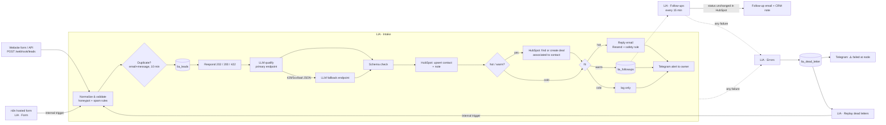
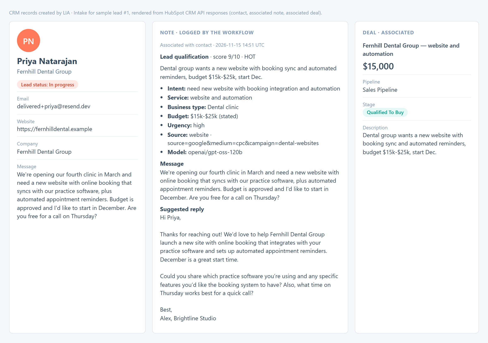
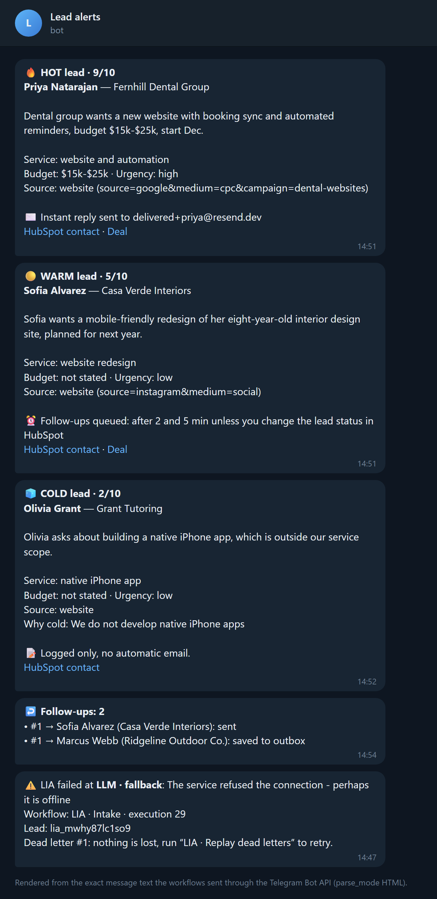
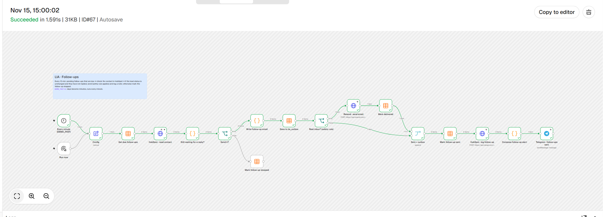
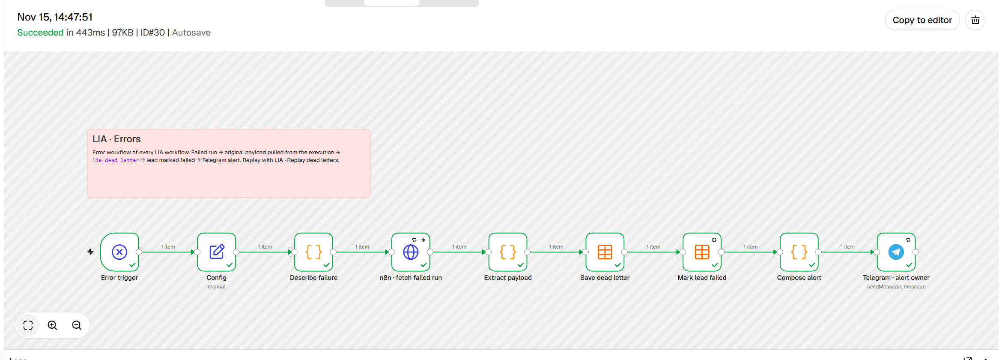

# Lead Intake Agent

An n8n lead-intake pipeline built to run in production. Each inbound lead is validated, checked for spam and duplicates, and acknowledged in milliseconds. An LLM then qualifies it into strict JSON. The pipeline upserts the lead into HubSpot (contact, note and, for good leads, a deal) and alerts the owner on Telegram. What happens next depends on the score: hot leads get an instant personal reply, warm leads get follow-ups that cancel themselves when a human takes over, and cold leads are only logged. Every external call retries. A failed run never loses a lead: the payload goes to a dead-letter table, the owner is alerted, and one click replays it.

It exists because the most common small-business automation request is "leads sit in an inbox for hours". The fix is easy to demo and hard to run reliably, so most of the work here went into the reliability side.

**Video:** (link coming)


## Architecture



| Workflow | Trigger | What it does |
|---|---|---|
| `LIA · Intake` | Webhook `POST /webhook/leads`, internal trigger | The main pipeline above |
| `LIA · Form` | n8n hosted form `/form/lia-contact` | Thin adapter that hands form submissions to Intake (n8n forms cannot share a workflow with *Respond to Webhook*) |
| `LIA · Follow-ups` | Schedule, every 15 min | Sends day-2 and day-5 follow-ups to warm leads nobody has touched |
| `LIA · Errors` | Error trigger (set as the error workflow of every LIA workflow) | Dead letter, marks the lead failed, Telegram alert |
| `LIA · Replay dead letters` | Manual | Re-runs failed payloads through Intake, gives up after 3 attempts |

State lives in four n8n Data Tables: `lia_leads` (audit log of every submission), `lia_followups`, `lia_outbox` (every email, sent or not) and `lia_dead_letter`.

## The flow, step by step

1. **Accept.** `POST /webhook/leads` takes JSON with `name` (or `first_name`/`last_name`), `email`, `company`, `website`, `message`, `budget`, `source`, and UTM as an object (`utm`), as `utm_*` fields, or as query parameters. Field names are matched loosely, so `Email`, `work_email` and `E-mail` all work.
2. **Normalize and validate.** The pipeline trims and strips control characters, lowercases the email, splits the name, normalizes the website to `https://domain`, parses the budget (`"$5k-10k"` becomes 5000, the lower bound) and caps field lengths. An invalid email or an empty message gets a **422** with the list of errors.
3. **Cheap spam checks before any LLM spend.** A filled honeypot field (`hp`), three or more links, or a sales-pitch keyword plus a link marks the lead as spam. Bots get the same 202 as humans, so they learn nothing.
4. **Idempotency.** The fingerprint is a hash of the email plus the normalized message. The same fingerprint within `DEDUPE_WINDOW_MIN` (10 min) gets **200 `{"status":"duplicate"}`** and nothing else happens. Replays skip this check on purpose.
5. **Log, then respond.** The row is written to `lia_leads` *before* the response, so a duplicate sent a second later is caught. The webhook answers **202 `{"status":"accepted","lead_id":...}`**, typically in 170–310 ms, and the rest runs after the response.
6. **Qualify.** The LLM call is an HTTP Request to any OpenAI-compatible `/chat/completions` endpoint with `response_format: json_object`. It runs on Groq `openai/gpt-oss-120b` by default (about 0.5 s). If the primary endpoint fails after retries (429, 5xx, timeout), or returns something that is not the expected JSON, the optional **fallback endpoint** is called. The prompt marks lead data as untrusted (`<lead>…</lead>` is data, not instructions).
7. **Schema check.** The answer is validated and coerced: the score is clamped to 1–10, enums are checked and strings truncated. A broken answer is **downgraded to cold + "needs review"** and is never automated.
8. **HubSpot.** The contact is upserted by email (`batch/upsert`, `idProperty=email`) with the name, company, website, message and lead status (hot `IN_PROGRESS`, warm `OPEN`, cold `NEW`). A note holds the full qualification, the original message and the suggested reply. For hot and warm leads, the pipeline first searches for an existing deal with the same name on this contact and creates one only if there is none, so a replay never creates a second deal. New deals are named `<company> — <service_interest>`, take their amount from the stated budget, go in the default pipeline at stage `qualifiedtobuy` (score ≥ 8) or `appointmentscheduled`, and are associated with the contact. Spam never reaches the CRM.
9. **Act on the fit.**
   * **hot:** an instant reply (the LLM draft) goes to `lia_outbox`, then through the **email safety rule**, then to Resend.
   * **warm:** two rows go into `lia_followups`: the reply draft on day 2 and a short nudge on day 5.
   * **cold:** logged only.
10. **Alert.** The owner gets a Telegram message with 🔥/🟡/🧊, the score, a one-line summary, service, budget, urgency, source/UTM, what the automation did, and deep links to the HubSpot contact and deal.
11. **Close the loop.** `lia_leads` is updated with the fit, score, HubSpot ids, Telegram message id, which LLM answered, and the action taken.

**Follow-ups:** every 15 minutes, `LIA · Follow-ups` loads due rows and reads each contact from HubSpot. It sends only if the lead status is still the one set at intake and no reply is logged (`hs_sales_email_last_replied`). If someone changed the status in HubSpot, the follow-up is marked `stopped` with the reason. Sent follow-ups are logged as HubSpot notes, and the owner gets one Telegram summary per batch. With `DEMO_FAST=1`, days become minutes and the schedule runs every minute.

**Email safety rule:** only addresses that match `REAL_INBOX_REGEX` are really emailed. By default that is Resend's test inbox `delivered+<label>@resend.dev`. Every other address is written to `lia_outbox` with `delivered=false`. You can run the whole pipeline on realistic data without emailing anyone, then widen the regex when going live.

## Qualification schema

The model must return exactly this object. The workflow validates it, and nothing downstream trusts raw model output.

```json
{
  "score": 9,
  "fit": "hot",
  "intent": "need new website with booking integration and automation",
  "service_interest": "website and automation",
  "business_type": "Dental clinic",
  "budget_estimate": "$15k-$25k",
  "urgency": "high",
  "summary": "Dental group wants a new website with booking sync and automated reminders, budget $15k-$25k, start Dec.",
  "reply_draft": "Hi Priya,\n\nThanks for reaching out! ...",
  "disqualify_reason": null
}
```

| Field | Type | Rule |
|---|---|---|
| `score` | integer 1–10 | Clamped; a non-numeric value means "needs review" |
| `fit` | `hot` \| `warm` \| `cold` \| `spam` | hot 7–10, warm 4–6, cold 2–3, spam 1. A stated budget ≥ $3k for an in-scope service means hot unless there is a clear disqualifier; low urgency alone never downgrades it |
| `intent` | string | ≤ 200 chars |
| `service_interest` | string | 2–5 words, used in the deal name and email subjects |
| `business_type` | string | ≤ 80 chars |
| `budget_estimate` | string \| null | Stated budget or the model's estimate |
| `urgency` | `high` \| `medium` \| `low` | Anything else becomes `medium` |
| `summary` | string | One sentence |
| `reply_draft` | string | 60–120 words in the lead's language. Promises no prices, deadlines or results and invents no facts. Empty for spam |
| `disqualify_reason` | string \| null | Why the lead is cold or spam |

## Error handling and retries

* **Retries on every external call:** HubSpot, the LLM endpoints, Resend, Telegram and the n8n API all use `Retry On Fail`: 3 tries 3 s apart (fallback LLM: 2 tries 5 s apart; n8n API: 2 tries). n8n's built-in retry uses a fixed interval. The fallback endpoint is the second line of defence for the LLM step.
* **Error workflow:** every LIA workflow has `LIA · Errors` as its error workflow. When an execution fails, it:
  1. reads the failed execution through the n8n API and extracts the original trigger payload (webhook body plus UTM query, or form fields),
  2. stores workflow, node, error, execution id, lead id and payload in `lia_dead_letter`,
  3. marks the lead `failed` in `lia_leads` with the node and error,
  4. sends `⚠️ LIA failed at <node>: <error>` to Telegram with the dead-letter id.
* **Replay:** `LIA · Replay dead letters` feeds each open dead letter back into Intake through its internal trigger, marks it `replayed`, and gives up after 3 attempts (`replay_failed`).
* **Idempotent writes:** contacts are upserted by email, and an existing deal is reused. A lead that failed halfway can be replayed safely.
* **Nothing is lost:** the submission is in `lia_leads` before the 202 is sent, and every email is in `lia_outbox` before it is sent.

Failure drill (it was run against this build): point both LLM endpoints at something dead and post a lead. The client still gets a 202. Intake fails at `LLM · fallback`, `LIA · Errors` stores the payload and alerts. Fix the endpoint, run Replay, and the same lead comes out processed (hot 8/10, contact plus deal) with the note `replay of dead letter #1`.

## Run it

**Requirements:** n8n with Data Tables (tested on 2.47.5), Python 3.10+ (standard library only), a HubSpot private app or service key with the `crm.objects.contacts.read/write` and `crm.objects.deals.read/write` scopes, a Telegram bot token plus your chat id, an OpenAI-compatible LLM endpoint, and a Resend API key with a verified sending domain.

```bash
cp .env.example .env          # fill in the values (each secret can also be NAME_FILE=path)
python tools/build.py         # creates data tables, credentials and 5 workflows, activates them
python tools/send_samples.py  # 10 sample leads end-to-end, prints a verification table
python tools/cleanup_hubspot.py --tables   # remove the sample records, empty the tables
```

`build.py` talks to the n8n public API and is idempotent: workflows are matched by name and updated in place, so webhook URLs survive rebuilds. It adds missing table columns and creates each credential once. Secrets go only into n8n credentials; the workflows reference them by id. `python tools/build.py --export` writes sanitized copies to `workflows/`.

To import by hand instead, import `workflows/*.json`, create the credentials named in them (`LIA · LLM primary`, `LIA · LLM fallback`, `LIA · HubSpot`, `LIA · Telegram`, `LIA · Resend`, `LIA · n8n API`), replace the `REPLACE_WITH_…` workflow ids, create the four data tables, and edit the **Config** node in each workflow.

### Configuration

Non-secret settings are written into a **Config** node at the start of each workflow. n8n Variables would be the natural home, but they need a paid license; with one, the Config node can read `$vars` instead.

| Variable | Default | Purpose |
|---|---|---|
| `N8N_URL`, `N8N_API_KEY` | `http://127.0.0.1:5678` | n8n instance and public API key |
| `LLM_BASE_URL` | `https://api.groq.com/openai/v1` | Any OpenAI-compatible endpoint (Groq, OpenAI, OpenRouter, …) |
| `LLM_MODEL` | `openai/gpt-oss-120b` | Model id at that endpoint |
| `LLM_API_KEY` | | Stored as the `LIA · LLM primary` Header Auth credential |
| `LLM_REASONING_EFFORT` | `low` | Sent only if set (for reasoning models) |
| `LLM_FALLBACK_BASE_URL`, `LLM_FALLBACK_MODEL`, `LLM_FALLBACK_API_KEY` | bridge on `:41220`, `haiku` | Optional second endpoint |
| `HUBSPOT_TOKEN` | | HubSpot service key (stored as a `hubspotAppToken` credential) |
| `HUBSPOT_PORTAL_ID`, `HUBSPOT_UI_DOMAIN` | detected | Used for deep links in alerts |
| `TELEGRAM_BOT_TOKEN`, `TELEGRAM_CHAT_ID` | | Owner alerts |
| `RESEND_API_KEY`, `MAIL_FROM`, `MAIL_REPLY_TO` | | Outgoing email |
| `REAL_INBOX_REGEX` | `^delivered(\+…)?@resend\.dev$` | Email safety rule |
| `BUSINESS_NAME`, `BUSINESS_PROFILE`, `SENDER_NAME` | fictional studio | Context for the qualifier and the reply signature |
| `WEBHOOK_PATH`, `FORM_PATH` | `leads`, `lia-contact` | URLs |
| `DEDUPE_WINDOW_MIN` | `10` | Idempotency window |
| `FOLLOWUP_DAYS` | `2,5` | Follow-up schedule |
| `DEMO_FAST` | `0` | `1` turns days into minutes and runs the scheduler every minute |

### Optional: local LLM bridge

`bridge/claude_bridge.py` is a small (~300 lines), stdlib-only, OpenAI-compatible server (`POST /v1/chat/completions`, `GET /v1/models`, `GET /health`). It forwards requests to a locally logged-in Claude Code CLI. It supports `response_format: json_object`: it instructs the model to answer in JSON only, extracts the first valid JSON object, and retries once. It also has bearer-key auth and a concurrency limit. The bridge is useful as a fallback or for development without a paid key; any OpenAI-compatible endpoint can take its place.

```powershell
bridge\start.ps1     # hidden background process, logs in logs\, generates bridge\.key on first run
bridge\stop.ps1
```

## Sample run

`tools/send_samples.py` posts 10 fictional leads (2 hot, 3 warm, 2 cold, 2 spam, 1 duplicate). It waits for background processing, then checks every lead against the HubSpot API (contact and deal exist), the Telegram message id, the outbox and the follow-ups.


## Screenshots

| | |
|---|---|
|  |  |
| CRM records created for sample lead #1, rendered from HubSpot API responses | Owner alerts, rendered from the exact text the workflows sent |
|  |  |
| `LIA · Follow-ups`: one batch with an emailed and an outbox-only follow-up, merged into one alert | `LIA · Errors` handling a failed LLM call |

The hosted form used for the video: [docs/lead-form.png](docs/lead-form.png).

## Repository layout

```
bridge/        OpenAI-compatible bridge to a local Claude CLI (optional fallback LLM)
docs/          screenshots
tools/
  build.py           creates tables, credentials and workflows via the n8n API; --export
  send_samples.py    10 sample leads + verification table
  cleanup_hubspot.py removes sample records (example.com / resend.dev only) and empties tables
  common.py          .env loading, n8n and HubSpot REST helpers
workflows/     sanitized workflow exports (credential ids and instance ids replaced)
.env.example   every setting, with defaults
```

## Notes and limits

* The webhook has no auth so that a plain website form can post to it. Put it behind a reverse proxy with rate limiting, or add an HMAC header check in *Normalize*, if it is exposed publicly.
* "Has the lead replied?" relies on HubSpot's email reply tracking (`hs_sales_email_last_replied`) and on lead status. For inbox-level reply detection, add a Gmail or IMAP trigger that changes the lead status.
* Data Tables keep the demo self-contained. For heavy volume, swap them for Postgres; only the table nodes change.

## License

MIT © 2026 lflsyyyy
